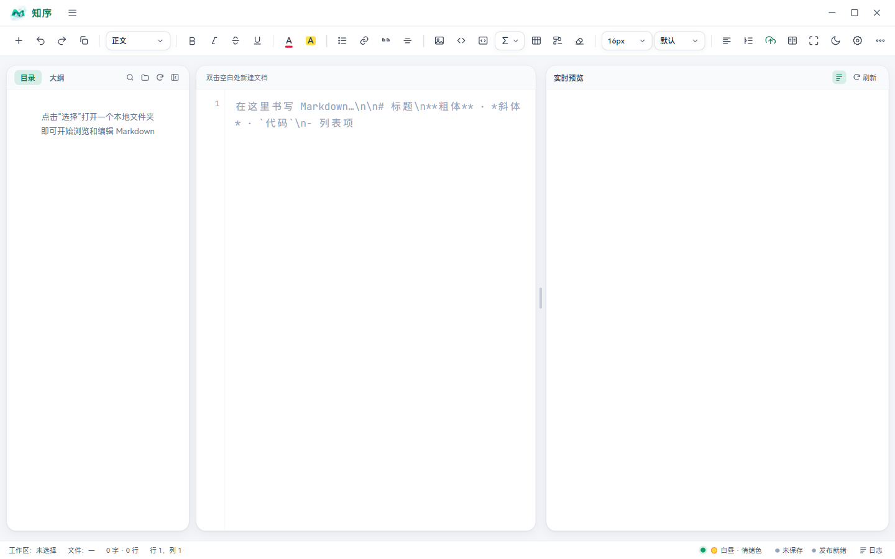
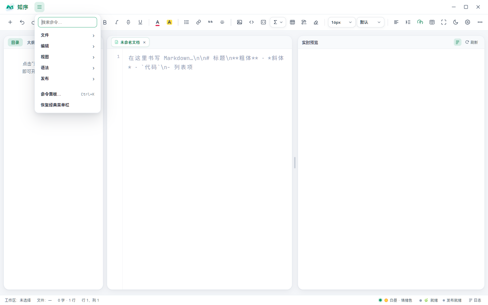
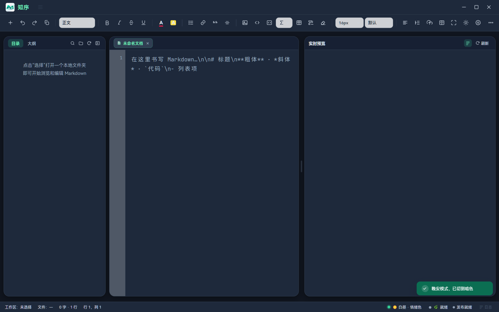

# 知序

[](https://github.com/DOIT008/zhixu/releases)
[](https://github.com/DOIT008/zhixu/releases)
[](LICENSE)

> 一款现代、克制的桌面 Markdown 编辑器。写作、预览、发布，一个窗口全部搞定。

知序（Zhixu）是基于 Electron 的 Windows 桌面 Markdown 编辑器。它把本地工作区、语雀式排版工具栏、实时预览、VitePress 兼容渲染和可选的 GitHub 发布流程整合在一起，界面采用纯色层次设计，不依赖网络即可离线写作。



---

## 为什么选知序

- **所见即所得的排版**：语雀风格工具栏，粗斜体、颜色、高亮、对齐、列表、表格、代码块一键插入，写的是通用 Markdown / 内联 HTML，换任何编辑器都能打开。
- **为 VitePress 而生**：内置常用 VitePress 语法预览（容器、代码组、Frontmatter、`[[toc]]`、行高亮等），并能在发布时自动同步站点侧边栏。
- **发布前先看清楚**：Git blob 精确对比远端差异，逐文件查看 diff、勾选要发布的内容，再一次性提交并触发 Actions。
- **写作体验的细节**：多标签、大纲与目录导轨、查找替换、版本快照、草稿恢复、命令面板、写作统计、关系图谱、暗色与情绪主题。
- **完全离线**：Markdown 渲染、语法高亮、KaTeX 公式字体全部内置，不联网也能完整写作与预览。

---

## 下载

Windows x64 用户可直接使用编译好的安装包，无需配置 Node.js 环境：

| 版本 | 文件 | 说明 |
| --- | --- | --- |
| 最新 | [Releases 页面](https://github.com/DOIT008/zhixu/releases/latest) | 自动构建的正式版，含安装包与便携版 |
| v1.0.0 | `知序-1.0.0-x64.exe` | NSIS 安装程序，可自定义安装目录 |
| v1.0.0 | `知序-1.0.0-portable.exe` | 免安装便携版，双击即用 |

> 应用未做代码签名，首次运行可能触发 Windows SmartScreen 提示，选择「仍要运行」即可。校验版本请对照 Releases 页面的变更记录。

---

## 快速开始

### 环境要求

- Node.js 18+（推荐 20 / 22）
- Windows 10 / 11（打包产物为 x64）

### 本地运行

```bash
cd markdown-studio
npm install
npm start
```

首次 `npm install` 会下载 Electron 二进制。若网络受限，可使用国内镜像：

```bash
set ELECTRON_MIRROR=https://npmmirror.com/mirrors/electron/
set ELECTRON_BUILDER_BINARIES_MIRROR=https://npmmirror.com/mirrors/electron-builder-binaries/
npm install
```

### 打包 Windows 安装包

```bash
# NSIS 安装包 + 便携版（dist/ 目录）
npm run build:win

# 仅便携版
npm run build:portable

# 仅展开目录，不生成安装包（调试用）
npm run pack
```

产物：

- `dist/知序-1.0.0-x64.exe`：NSIS 安装程序
- `dist/知序-1.0.0-portable.exe`：免安装便携版

---

## 界面一览

### 紧凑菜单

标题栏的 `☰` 按钮收纳了全部功能，两级结构：`菜单 → 分类 → 动作`，顶部搜索框可直接过滤所有命令。若更习惯传统布局，可从菜单底部「恢复经典菜单栏」切回经典菜单栏，随时可再切回。



### 暗色主题

工具栏一键切换明暗，状态栏的情绪色入口提供清晨 / 白昼 / 黄昏 / 夜间四套主题，强调色会同步到目录导轨、选中态与各类标记。



---

## 功能说明

### 1. 工作区与文件

- 选择任意本地文件夹作为工作区，目录树自动忽略 `.git`、`node_modules`、`dist` 等目录。
- 目录树右键：新建文件 / 文件夹、重命名、删除到回收站（可恢复、二次确认）、在资源管理器中打开。
- 全局搜索（`Ctrl+Shift+F`）：按文件分组展示匹配行，点击结果跳转并高亮；支持正则、区分大小写、上下文。
- 多标签：同时打开多个文档，每个标签独立保存光标、滚动位置与撤销历史；`Ctrl+W` 关闭、`Ctrl+Tab` 切换。
- PDF 导出：把预览渲染结果导出为 A4 PDF，含页码与中文字体。
- 所有读写都经过工作区边界校验，阻止 `../` 越权访问。

### 2. 编辑与排版

- 语雀式工具栏：标题 / 正文、字号、粗体、斜体、删除线、下划线、文字颜色、高亮、对齐、列表、任务列表、链接、引用、图片、代码、表格、缩进等。
- 颜色与高亮写入**通用内联 HTML**（`<span style="color:…">`、`<mark>`），任何 Markdown 软件都能正确显示；早期自研语法仍兼容，发布时自动转换。
- 应用内撤销 / 重做历史栈、格式刷、清除格式；智能续列表、任务列表点击回写源文件。
- 查找替换（`Ctrl+F` / `Ctrl+H`）：支持正则、全字匹配、逐个 / 全部替换（`$1` 反向引用）。
- 上标 / 下标 / 行内公式 / 公式块（KaTeX，按需加载）。
- 自动保存、本地版本快照（最多 40 份）与草稿恢复，避免崩溃丢失内容。

### 3. 视图与导航

- 三种视图循环：分屏 / 仅编辑 / 仅预览；分屏可拖拽调整宽度，比例与侧栏折叠状态都会持久化。
- 预览区右侧**目录导轨**：悬浮章节时横线平滑延长并显示标题，点击跳转到对应章节，选中态跟随主题色。
- 大纲面板按标题层级导航，点击跳转编辑区与预览；`Ctrl+K` 命令面板直达任意功能。
- 写作统计（字数、行数、阅读时长）、文档关系图谱（缩放 / 拖拽 / 筛选）、语法演练场。
- 窄窗口下工具栏自动收纳溢出图标，发布、主题等高频按钮固定保留。

### 4. VitePress 兼容预览

预览渲染器覆盖常见 VitePress / GitHub 语法子集：

- Frontmatter 隐藏、自定义容器（`::: tip/info/warning/danger/details`）、代码组、代码块标题与行高亮。
- 离线语法高亮（JS/TS、Python、Vue、CSS、JSON、Bash、SQL、Go、Rust 等），内置 JetBrains Maple Mono 字体。
- `[[toc]]` 目录、标题锚点（含 `{#id}` 自定义）、GitHub Alerts、Emoji 缩写、`::: raw` 容器。

> 预览覆盖的是 Markdown It / VitePress 常见语法子集，不执行 Vue 组件编译；目标站点需保留相应主题配置。

### 5. 发布到 GitHub / VitePress

1. 在「发布 → GitHub 发布设置」填写 Owner、仓库名、分支、Token（需 `repo` 权限，触发 Actions 需 `workflow`）、目标目录与 Workflow 文件。
2. Token 在 Windows 上优先用 Electron `safeStorage`（DPAPI）加密存储；**请勿将含 Token 的配置提交到公共仓库**。
3. 点击工具栏的**发布图标**（或 `Ctrl+Shift+P`）：应用用 Git blob SHA 精确对比远端，列出修改 / 新增 / 删除文件。
4. 展开逐行 diff 确认，勾选要发布的文件，一次提交完成并触发 `workflow_dispatch`。
5. 发布前体检会检查图片落地、死链与 sidebar 配置；侧边栏的新增 / 删除 / 改名 / 移动会同步到 `.vitepress/config.mts`。

也支持保存后单文件静默发布（自动发布开关），两种方式共用同一套语法转换规则。

---

## 快捷键

| 快捷键 | 功能 |
| --- | --- |
| `Ctrl/Cmd + S` | 保存 |
| `Ctrl/Cmd + Shift + F` | 全局文档搜索 |
| `Ctrl + F` / `Ctrl + H` | 查找 / 替换 |
| `Ctrl + K` | 命令面板 |
| `Ctrl + Shift + P` | 预览变更并发布 |
| `Ctrl + W` / `Ctrl + Tab` | 关闭 / 切换标签 |
| `Ctrl + B` | 折叠 / 展开侧栏 |
| `Ctrl + ]` / `Ctrl + [` | 增加 / 减少缩进 |
| `Ctrl + Z` / `Ctrl + Y` | 撤销 / 重做 |

---

## 项目结构

```text
markdown-studio/
├── package.json                  # 依赖、脚本、electron-builder 配置
├── build/                        # 应用图标（ico / png）
├── docs/screenshots/             # README 界面截图
└── src/
    ├── main/                     # Electron 主进程
    │   ├── main.js               # 窗口生命周期、单实例
    │   ├── ipc.js                # IPC 路由
    │   ├── workspace.js          # 工作区 / 文件读写 / 搜索 / 路径校验
    │   ├── config.js             # 配置读写（safeStorage 加密）
    │   ├── github.js             # GitHub 提交、差异扫描、Actions 触发
    │   ├── vitepress.js          # 发布体检、资源处理
    │   ├── vitepress-sidebar.js  # sidebar 增删改移动同步
    │   ├── graph.js              # 文档关系图谱
    │   ├── backup.js             # 草稿与快照
    │   ├── publish-report.js     # 发布前体检
    │   ├── templates.js          # 文档模板
    │   ├── history.js            # 版本历史
    │   ├── updates.js            # 更新检查
    │   ├── pdf.js / menu.js
    ├── preload/preload.js        # contextBridge 安全暴露 API
    └── renderer/
        ├── index.html            # 界面结构
        ├── styles.css            # 布局、纯色主题、响应式
        ├── markdown.js           # 轻量 Markdown → HTML 渲染
        ├── app.js                # 界面交互与业务逻辑
        └── assets/               # 字体、KaTeX 资源
```

---

## 常见问题

| 场景 | 处理 |
| --- | --- |
| GitHub Token 失效 / 发布 401 | 重新生成带 `repo`（及 `workflow`）权限的 PAT，填入发布设置 |
| 打包时下载 Electron 失败 | 配置 `ELECTRON_MIRROR` 镜像后重新安装 |
| exe 触发 SmartScreen | 应用未签名；用代码签名证书签名，或说明来源后选择仍要运行 |
| 发布后图片丢失 / 死链 | 用「发布前体检」检查图片映射与链接，确认资源落在 VitePress `public` 目录 |
| 改了文档名或移动目录后站点链接失效 | 发布流程会同步更新 sidebar 与链接映射 |

---

## 许可证

MIT
